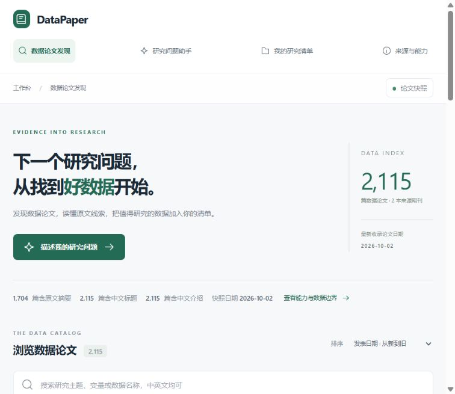

<div align="center">

# DataPaper

**从研究问题出发，找到值得进一步核验的数据论文。**

发现论文 · 理解来源 · 比较候选 · 沉淀研究清单

[快速开始](#-快速开始) · [功能介绍](#-能做什么) · [数据与能力边界](#-数据与能力边界) · [开发与测试](#-开发与测试)


</div>

---

研究数据往往散落在论文、仓库和补充材料中。DataPaper 将数据论文整理为可检索的中文阅读卡片，帮助研究者从一个问题出发发现候选、回到原文核对，再把有价值的线索保存下来。



<p align="center"><sub>工作台界面示意；论文数量与日期以实际运行时的数据为准。</sub></p>

## ✨ 能做什么

| 功能 | 你可以做什么 |
| --- | --- |
| 📚 **发现数据论文** | 按中英文关键词、学科、期刊和年份筛选；浏览列表按页加载。 |
| 🔎 **描述研究问题** | 将自然语言需求交给助手，结合关键词与可选的向量检索寻找候选论文。 |
| 🧾 **回到来源核验** | 查看标题、摘要、DOI 与原文链接，区分来源信息和模型整理内容。 |
| 🗂️ **建立研究清单** | 收藏论文、记录笔记、比较候选，并导出 Markdown。 |
| 👤 **跨设备使用** | 登录账户后保存收藏、笔记和最近阅读；访客清单保存在当前浏览器。 |
| 📱 **小程序** | 提供移动端论文发现与本地清单。详见 [小程序说明](miniprogram/README.md)。 |

> DataPaper 帮助发现和整理候选，不代替对原文、数据文件、使用许可及研究适用性的核验。

## 🚀 快速开始

### 环境要求

- Python 3.11 或更高版本
- Node.js 22.13 或更高版本与 npm
- Windows 用户可直接使用项目提供的启动脚本

### 1. 获取项目并安装依赖

```bash
git clone https://github.com/Kaiyang-Jia/data-paper-read.git
cd data-paper-read
python -m venv .venv
```

激活虚拟环境：Windows PowerShell 使用 `.\.venv\Scripts\Activate.ps1`；macOS / Linux 使用 `source .venv/bin/activate`。然后运行：

```bash
pip install -r requirements.txt
cd site
npm ci
cd ..
```

### 2. 启动工作台

```bash
python run_workspace.py
```

打开 **http://127.0.0.1:3000/**。Python API 默认运行在 `127.0.0.1:5000`；保持启动窗口打开。Windows 也可以双击 `启动网页.bat`，关闭时双击 `结束网页.bat`。

项目自带论文快照。首次运行无需配置模型密钥即可浏览；论文目录接口需要本地 Python 后端运行。启动失败时可检查 `.runtime/api.log` 和 `.runtime/web.log`。

### 3. 按需配置模型

将 `.env.example` 复制为根目录的 `.env`，按需填写：

| 配置项 | 用途 |
| --- | --- |
| `DEEPSEEK_API_KEY` / `DEEPSEEK_MODEL` | 中文论文卡片加工，以及启用时的推荐理由生成。 |
| `SILICONFLOW_API_KEY` / `EMBEDDING_MODEL` | 为论文和查询生成向量；当前实现支持硅基流动的 `BAAI/bge-m3`。 |
| `FAISS_INDEX_DIR` | 指向已构建的本地 FAISS 索引。仅填写密钥不会自动生成索引。 |
| `FLASK_SECRET_KEY` | 用于账户会话签名；正式部署应设置固定随机值。 |
| `USE_LOCAL_USER_DB` / `LOCAL_USER_DB_PATH` | 选择本地账户数据库及其存储位置。 |
| `SESSION_COOKIE_SECURE` | HTTPS 部署时设为 `true`；本地 HTTP 调试时保持 `false`。 |

密钥只保存在服务端或本机，不应提交到 GitHub。模型服务可能有调用限制或费用，请以服务商和账户的实际情况为准。

## 🧭 数据与能力边界

- 当前目录以数据论文为入口；论文发表日期不等同于数据覆盖年份，论文相关也不代表数据满足研究条件。
- 中文标题、简介和标签可能由模型生成，应对照原文；缺少来源或无法判断的条件仍需人工核验。
- “研究问题”可使用后端的关键词与向量混合检索；未配置向量服务或索引时会回退。浏览页的关键词筛选与语义检索是不同功能。
- 仓库内快照用于启动与复现，不等同于线上实时目录。服务器上的新论文、账户资料和索引不会自动写回本仓库。
- 定时更新需要服务器另行配置。增量更新脚本见 [`deploy/scheduled_update.py`](deploy/scheduled_update.py)，不会因为访问网页而自动触发采集。
- 微信小程序的正式网络访问需要按微信平台要求配置服务地址及合法域名，不能直接把本机地址当成线上地址。

## 🧩 项目结构

```text
DataPaper/
├── site/             网页工作台、页面组件与同源 API 代理
├── app.py            Flask API、账户接口与研究问题检索
├── research/         论文目录、来源补全、中文加工与账户逻辑
├── get_data/         采集、处理、数据库与 FAISS 索引
├── miniprogram/      微信小程序
├── deploy/           服务器更新脚本与部署说明
├── tests/            Python 测试
└── run_workspace.py  本地网页和 API 启动器
```

## 🛠️ 开发与测试

```bash
python -m unittest discover -s tests -v
cd site
npm test
npm run typecheck
npm run lint
npm run build
```

更新论文可使用 `python -m research.update_catalog`；完整流程依赖已配置的中文加工与向量服务，可能调用外部 API。运行前请确认模型配置、访问限制和费用。服务器部署与本机开发的区别见 [部署说明](deploy/README.md)。

## 📄 License

项目代码采用 [MIT License](LICENSE)。论文元数据、摘要及第三方数据的权利和使用条件以各自来源为准。
